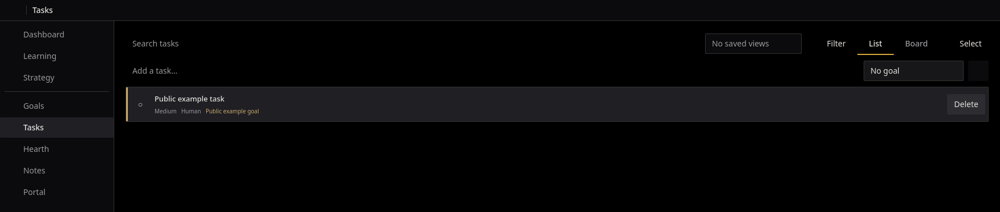

# Soliton

A local desktop planner for goals, tasks, notes, and the material behind them. A goal can have many tasks. A task keeps its link to that goal through deletion, Undo, and an engine restart. The calendar, list, and board are views over records kept by the same Rust engine.



## Try the planner engine

From the repository root, use Rust 1.94, Cargo, a C compiler, and Python 3. Cargo fetches the locked dependencies on the first build.

```sh
cargo build --locked --features bundled-sqlite --bin soliton
python3 examples/first-run.py target/debug/soliton
```

The [first-run example](examples/first-run.py) creates a goal called **Example project**, attaches **Review the example** to it, trashes the task, and restores it. Then it closes the engine and starts a new process. A pass means the recovered task still has both its title and its original goal ID. The workspace is temporary.

## SQLite selection

The recommended command above enables `bundled-sqlite`, which builds the patched SQLite source included by the pinned rusqlite 0.41 dependency. The candidate keeps system SQLite as its default feature configuration. For that variant, install pkg-config and the system SQLite development files, then run `cargo build --locked --bin soliton`.

Before opening database files supplied by another party, use SQLite 3.54.0 or a distribution build with the corresponding security fix. The test system reports SQLite 3.53.4, with backport status unestablished; the bundled variant avoids relying on that unknown system patch state. Both modes passed the planner and recovery checks. The bundled suite also asserts the actual SQLite runtime version is at least 3.54.0. [RUSTSEC-2026-0459](https://rustsec.org/advisories/RUSTSEC-2026-0459.html)

## Open the desktop

Install Quickshell (`qs`), Qt Quick Controls, Layouts and Dialogs, Qt SVG, and the Qt folder-list model. After the engine build, launch with a fresh workspace.

```sh
mkdir -p bin
cp target/debug/soliton bin/soliton
SOLITON_DATA="$(mktemp -d)" ./launch
```

For a workspace you intend to keep, set `SOLITON_DATA` to a stable directory and back it up before upgrades. The planner runs locally without a model. Local inference uses a configured `SOLITON_LLM_MANAGER`, and the console integration needs a separate `ovrin-harness` executable.

## What has been exercised

The 0.5.30-based candidate passed 65 kernel and 30 planner-library tests with system SQLite, and 66 kernel tests (including a bundled SQLite version check) plus the same 30 planner tests with bundled SQLite. An isolated run drove the actual QML interface with mouse and keyboard, saved a goal and task, deleted the task, and clicked Undo. A separate engine process confirmed the association survived. Fresh-machine desktop installation and optional integrations still need verification.

Run `cargo test --locked -p soliton-kernel --lib` to repeat the kernel suite. See [source basis](SOURCE_BASIS.md) for portability changes and [license status](LICENSE_STATUS.md) for third-party scope.

---

**[Explore OVRIN Labs](https://ovrinlabs.ca/)** · [Citium research](https://citium.ovrinlabs.ca/) · [Zavent data tools](https://zaventdata.com/)

[Apache-2.0 license](LICENSE) · [Contributing](CONTRIBUTING.md) · [Report a vulnerability privately](SECURITY.md)
